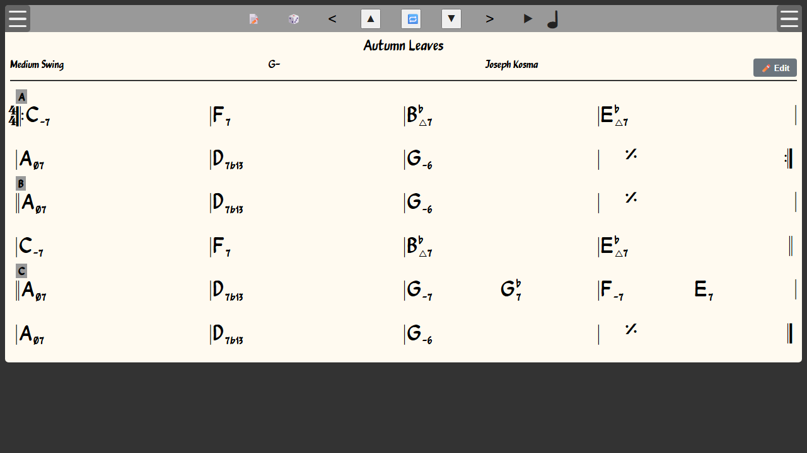
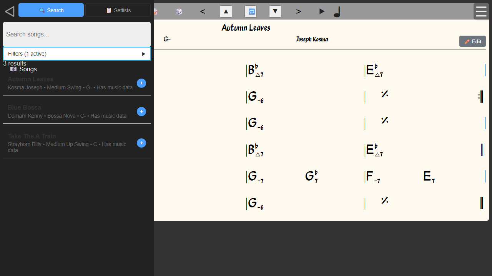

# 03 — In the browser

> **Runtime-bound: Node and Chromium.** This page runs the real app under Vite
> and drives it in Chromium through Playwright. Without them it fails; it does
> not skip.

The pages before this one read files and the CLI. This one runs
`tests/playwright/walkthrough.spec.js`, whose assertions are the claims below,
and the pictures are taken from the render those assertions ran against. They
are recorded, never compared: a test that diffs images fails on a font and gets
switched off, and the assertions are the regression check.

```python
>>> import json, os, shutil, subprocess, tempfile
>>> npx = shutil.which("npx")
>>> npx is not None
True
>>> report = os.path.join(tempfile.mkdtemp(), "walkthrough.json")
>>> _ = subprocess.run(
...     [npx, "playwright", "test", "tests/playwright/walkthrough.spec.js",
...      "--reporter=list,json"],
...     env={**os.environ, "PLAYWRIGHT_JSON_OUTPUT_FILE": report},
...     check=True,
... )
>>> with open(report, encoding="utf-8") as results:
...     specs = json.load(results)["suites"][0]["specs"]
>>> [(spec["title"], spec["ok"]) for spec in specs]
[('a chart renders from the Jazz 1460 book, and transposes', True),
 ('a setlist built from search becomes a filter', True)]

```

The spec starts Vite on port 1234, or on `LEO_PORT` when that is set. Outside
CI it reuses a server already listening there, and would then be testing
whatever that server is serving.

## A chart

A song's page is its chart: title, style, key and composer across the top, and
the changes below, drawn by `ireal-renderer` from the bundled iReal books.
Autumn Leaves opens on `C-7 F7 B♭△7 E♭△7`.



▲ in the top bar transposes up a semitone. Every chord moves, `C-7` becomes
`D♭-7`, and the key reads `G#- (1)`: the new key, and how far it has moved.

## A setlist is a filter

The left menu searches every song in the books. **+** on a result adds it to a
setlist; the first one asks for the setlist's name and creates it. Under
**Filters**, each setlist is a choice, and choosing one narrows the results to
its songs, in the setlist's order.


